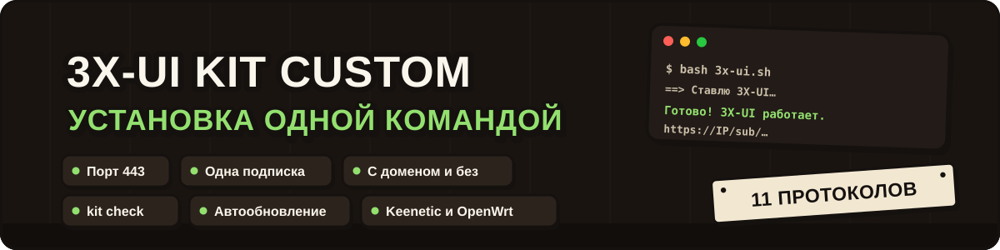

<div align="center">



**Установка 3X-UI: 11 протоколов, один порт 443, одна подписка на всё**

[](manuals/3x-ui.md#протоколы)
[](https://github.com/MHSanaei/3x-ui)
[](https://github.com/GolubiatnikovRoman/3x-ui-kit-custom/commits)

</div>

---

> [!WARNING]
> **Проект – набор скриптов с открытым кодом.** Он не оказывает услуг связи и не предоставляет доступ
> к серверам. Вы ставите его на собственный сервер и сами отвечаете за соблюдение законодательства
> своей страны. Проект создан в образовательных целях.

**3X-UI KIT** превращает чистый VPS в готовый VPN-сервер за несколько минут. Скрипт ставит
официальную панель [3X-UI](https://github.com/MHSanaei/3x-ui), настраивает все популярные
протоколы, сертификат и файрвол и выдаёт одну ссылку-подписку. Её можно вставить в любое
приложение – оно само получит подходящие ему протоколы. Домен не нужен.

<div align="center">

</div>

## Возможности

- 🧩 **До 11 протоколов на одном порту 443.** Панель, подписка и все TCP-протоколы спрятаны за одним портом,
  а на случайный заход сервер показывает обычный сайт. Протоколы: VLESS REALITY, VLESS XHTTP + REALITY,
  VLESS WebSocket + TLS, Trojan gRPC + TLS, VMess WebSocket + TLS, Shadowsocks 2022, Hysteria2, TUIC v5,
  AmneziaWG, AmneziaWG 3.1, MTProto (прокси для Telegram). Установщик спрашивает, что ставить: «Стандарт»
  (основной набор) или «На выбор» по номерам, хоть один протокол. Слабому серверу меньше процессов и памяти.
- 🔗 **Одна подписка на все приложения.** Hiddify, Happ, v2rayN, Karing, Clash Verge и FlClash
  получают свой формат и только те протоколы, которые распознают.
- 🧭 **Раздельная маршрутизация.** Через VPN идут только зарубежные сервисы, остальное – напрямую.
  Правила приезжают вместе с подпиской, DNS не течёт.
- 🥷 **Маскировка.** Со своим доменом на сервере стоит ваш сайт, без него сайт подбирается среди соседей
  по подсети. REALITY работает с `xtls-rprx-vision`.
- 👥 **Пользователи во все протоколы сразу.** Один пользователь – одна подписка, общий лимит трафика,
  срок и число устройств. Меню `kit` работает как у x-ui: выбрали цифру – готово.
- 💾 **Резервная копия и переезд на новый сервер одной командой.** Копия сохраняет подключения, ключи
  и пользователей, а на чистом VPS (даже с другим IP) сервер поднимается из неё за несколько минут.
- 🔄 **Обновления KIT появятся после первого подписанного релиза CUSTOM.**
- 🩺 **Проверка и починка сервера** из меню `kit`.
- 🧹 **Полное удаление.** Пункт «Удалить KIT с сервера» убирает панель, подписку, настройки и сертификаты, а ваш SSH и чужие сертификаты не трогает.

## Что понадобится

- VPS с **Ubuntu 22.04/24.04** или **Debian 12/13** и доступом root по SSH
- Свободные порты **443** и **80** – на свежем сервере они свободны

Нужен VPS? Я сам использую **[IS Hosting](https://ishosting.io/affiliate/NTg4MiM4)** и рекомендую его
(реферальная ссылка).

## Установка

Подключитесь к чистому тестовому VPS по SSH. Для установки нужны `git` и `python3`
(`sudo apt-get install git python3`). Укажите полный SHA опубликованного коммита CUSTOM
с поддержкой установки из checkout:

```bash
kit_commit="ПОЛНЫЙ_SHA_КОММИТА_CUSTOM"
git clone https://github.com/GolubiatnikovRoman/3x-ui-kit-custom.git &&
  cd 3x-ui-kit-custom &&
  git checkout --detach "$kit_commit" &&
  sudo bash scripts/3x-ui.sh
```

Замените `ПОЛНЫЙ_SHA_КОММИТА_CUSTOM` на SHA нужного коммита. Установщик берёт
`kit.sh` и `kit-sub.py` из этого checkout. До первого подписанного релиза обновления
KIT отключены.

Через пару минут скрипт покажет адрес панели, логин, пароль и подписку с QR-кодом.
Подробно – подключение приложений, дополнительные пользователи и параметры – в **[инструкции](manuals/3x-ui.md)**.

## Управление: меню `kit`

После установки на сервере появляется команда **`kit`**. Введите её **без аргументов**, и откроется меню, как у `x-ui`: выберите цифру, остальное спросит само. Запоминать команды не нужно, всё нужное внутри:

- **Пользователи, ссылки и подписки.** Список, добавить пользователя, показать все ссылки на подключения одним экраном, изменить лимит, выключить или удалить.
- **Протоколы, порты и маскировка.** Включить или выключить протокол, сменить сайт маскировки, порт, раздельную маршрутизацию, DNS.
- **Проверка сервера.** Быстрая и глубокая: глубокая видит, виноват сервер или ваша сеть, и умеет исправить безопасное.
- **Обновить kit и подписку, резервная копия, версии.**
- **Удалить KIT с сервера.**

> [!IMPORTANT]
> Обновляйте панель и ядро только через `kit` («Обновить kit и подписку»). Пункт обновления в меню `x-ui` ставит самую новую панель вместе с самым новым ядром Xray, на котором часть приложений (Karing, Hiddify и другие на sing-box) перестаёт подключаться. Если уже обновили через `x-ui`: `kit` → «Проверка сервера» → «Исправить безопасное» вернёт проверенное ядро.

Все команды (для скриптов и тех, кому так привычнее) и разбор «Если не подключается» – в **[инструкции](manuals/3x-ui.md)**.

## Генератор конфигов для маршрутизации в Happ

[Открыть генератор конфигов для маршрутизации в Happ](https://routing.happ.su/ru)

Лицензия: MIT, см. [LICENSE](LICENSE). Сторонние компоненты – [NOTICE.md](NOTICE.md).

## Благодарности

3X-UI KIT построен на работе авторов этих проектов:
[3X-UI](https://github.com/MHSanaei/3x-ui) ·
[Xray-core](https://github.com/XTLS/Xray-core) ·
[Mihomo](https://github.com/MetaCubeX/mihomo) ·
[Hysteria](https://github.com/apernet/hysteria) ·
[AmneziaWG](https://github.com/amnezia-vpn) ·
[XKeen](https://github.com/jameszeroX/XKeen)


## Подготовка релиза

Выполняй команды в корне репозитория в Bash. На Windows подойдёт Git Bash.

1. `bash tools/release.sh prepare 1.2.3` обновит версию и добавит черновик в `CHANGELOG.md` из коммитов после ближайшего достижимого тега. Для явной базы передай тег или SHA вторым аргументом после версии.
2. Отредактируй раздел выпуска и закоммить версию, changelog и скрипты.
3. `bash tools/release.sh sign` сверит закреплённые зависимости и подпишет `SHA256SUMS` локальным ключом. Путь к ключу можно передать аргументом.
4. `bash tools/release.sh verify` проверит подпись и суммы. Закоммить `SHA256SUMS` и `SHA256SUMS.sig`.
5. `bash tools/release.sh tag` проверит подпись и SHA256 и создаст локальный аннотированный тег на текущем коммите. Номер тега берётся из `VERSION`, описание — из `CHANGELOG.md`.
6. Когда коммит будет на GitHub, отправь тег командой `git push origin v1.2.3`, подставив версию выпуска. GitHub Actions опубликует GitHub Release с описанием из `CHANGELOG.md` после успешного CI, проверки подписи и SHA256.
